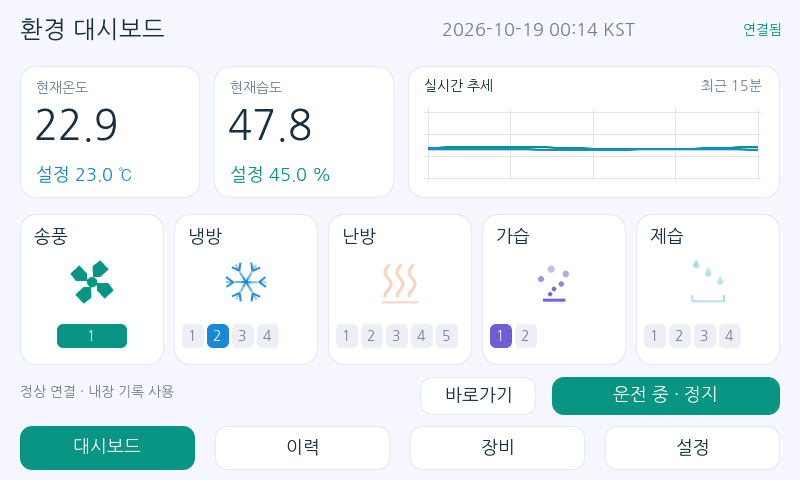
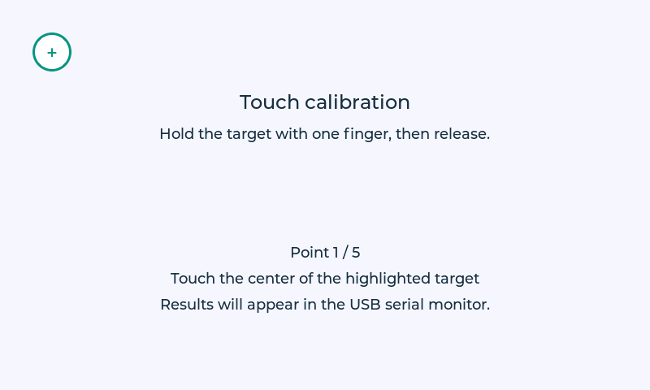

# MEX 5인치 터치 모니터

Waveshare ESP32-S3-Touch-LCD-5 **800×480**용 ESP-IDF **v6.1**, LVGL **9.6.0**, **EEZ Flow 없는** 모니터 펌웨어입니다. PC 서버나 Wi-Fi 없이 컨트롤러 한 대에 RS-485로 연결합니다.



## 구현 내용

- 밝은 대시보드, 현재/설정 온습도, 최근 15분 실시간 그래프, 운전/정지와 경보 표시.
- 직접 제작한 5종 × 12프레임 아이콘: 송풍 회전, 냉방 발광, 난방 상승, 가습 확산, 제습 수분 제거. 각 호기 번호 칩은 독립 수신 비트에 반응합니다.
- 비례 표시 선택은 모델 판별 없이 허용합니다. 게이지는 매뉴얼의 **계산값**이며 MEX150에 실제 비례 출력을 적용하지 않습니다. 단계/비례 제어 설정을 컨트롤러에 전송하는 미확인 명령과는 별도입니다.
- 확인된 레지스터 설정 쓰기, 출력 코일 수동 제어, 급수·배수. 실제 제어 전 확인 화면을 표시하며 수동 출력은 정지 상태만 허용합니다.
- 기본/전문가 설정, 온도·습도 빠른 값 각 2개, 한영 전환, RTC 시간, 화면 밝기/자동 꺼짐, 바로가기, 연결 주소.
- 설정온도·설정습도·냉방/난방/가습/제습 편차는 연결 없이 편집·저장하고, 재연결 시 자동 전송·재조회합니다. 화면 전환은 페이드 없이 즉시 수행합니다.
- 요일별 스케줄은 **모니터에서 실행**합니다. 모니터 전원과 유효한 RTC, 통신이 필요합니다. 동일 운전/정지 시각은 비활성이고 재연결·부팅 후 놓친 명령은 재생하지 않습니다.
- 내장 플래시: 최근 7일 분 단위 온습도 평균/최소/최대와 설정값, 최근 실제 경보 이력 최대 500건(선택 장비 주소로 구분), 모니터가 관찰한 호기별 적산. 연결되지 않은 구간은 적산하지 않습니다.
- 주소 미확인 설정은 메뉴에 **미지원**으로 표시합니다. 상세 목록은 [기능 검증표](docs/IMPLEMENTATION.md)를 참고하세요.

## VS Code ESP-IDF 확장에서 빌드

현재 WSL 폴더를 VS Code의 **WSL 창**에서 여세요. Windows에서 실행하는 EEZ와 WSL에서 실행하는 ESP-IDF 프로젝트를 분리했습니다.

1. `uv sync --locked`
2. `Developer: Reload Window`를 실행해 프로젝트의 ESP-IDF 환경 설정을 불러옵니다. 현재 IDF는 `/home/hajun/esp-idf-v6.1`입니다.
3. ESP-IDF 확장의 타깃을 `esp32s3`로 설정하고 **Build your project** 실행.
4. 보드 연결 후 확장에서 해당 직렬 포트를 선택하고 **Flash your project**, **Monitor your device** 실행.

`.vscode/settings.json`의 `idf.customExtraVars`에 `IDF_PATH`, `IDF_TOOLS_PATH`, `IDF_PYTHON_ENV_PATH`를 설정했습니다. ESP-IDF 확장 2.3은 이 환경 변수로 기존 설치를 인식하며, 구형 `idf.espIdfPath`·`idf.toolsPath`·`idf.pythonBinPath` 설정은 사용하지 않습니다. 다른 PC에서는 이 세 경로를 변경하세요. 객체 안의 경로는 `${workspaceFolder}` 대신 실제 절대 경로를 사용합니다. 확장의 Python 패키지는 이 프로젝트의 `.venv`를 사용합니다. 일반 VS Code 빌드 단축키는 `uv run --locked` 작업으로 연결되어 있습니다.

`Required dependency Python is missing`가 나오면 WSL 창에서 이 폴더를 열었는지 확인하고 창을 다시 불러오세요. 이 메시지는 확장의 Python 환경 선택이 비어 있어도 발생합니다. 설치 확인은 `uv run --locked python -c "import sys; print(sys.executable); import kconfiglib, idf_component_manager"`로 할 수 있습니다. `ESP-IDF: Select Current ESP-IDF Version`으로 다른 설치를 선택하면 확장이 수동 환경 변수 설정을 제거할 수 있으므로 프로젝트 `.venv` 경로도 다시 확인하세요. [공식 수동 설정 안내](https://docs.espressif.com/projects/vscode-esp-idf-extension/en/latest/installation.html#manual-configuration-of-esp-idf-and-tools-in-the-esp-idf-extension-for-vs-code).

동일 환경의 CLI:

```sh
uv run --locked python tools/idf.py build
uv run --locked python tools/run_device.py -p /dev/ttyACM0
```

최초 빌드에서 ESP-IDF Component Manager가 `dependencies.lock`에 고정된 LVGL을 가져옵니다. 프레임워크를 변경하지 마세요. USB Serial/JTAG로 로그를 출력하고 UART1은 RS-485 전용으로 사용합니다. 자동 플래싱은 수행하지 않았습니다.

### RTC 배터리 없는 상태의 한국시간 동기화

네 화면 상단은 `YYYY-MM-DD HH:MM KST`로 표시합니다. 경보·이력 날짜에도 연도를 표시하며 한국시간 `UTC+09:00`을 사용합니다. EEZ 프로젝트의 시계 폭과 코드 생성 템플릿을 수정했으므로 다시 Build/복사해도 연도 표시 공간과 페이드 없는 전환이 유지됩니다.

배터리가 없고 Wi-Fi 시간 서비스도 사용하지 않는 현재 구성에서는 완전한 전원 차단 뒤 PC 또는 수동 입력으로 현재 시각을 다시 받아야 합니다. 단순히 시간대를 바꾸거나 빌드 날짜를 넣는 방식으로 실제 현재 시각을 알아낼 수는 없습니다. 초기 공장값과 유효하지 않은 RTC 날짜를 신뢰하지 않고 `시간 미설정`을 표시합니다.

새 펌웨어를 확장으로 업로드한 뒤 **ESP-IDF Monitor를 닫고**, `Terminal → Run Task → Monitor: sync PC time`을 실행하세요. 선택된 `idf.port`로 PC의 현재 UTC 시각을 전달하고, 보드가 한국시간으로 적용합니다. 또는 다음 명령을 사용합니다.

```sh
uv run --locked python tools/sync_time.py -p /dev/ttyACM0
```

성공하면 PC에 `PC time synchronized: ... KST`, 보드 로그에 `USB PC synchronized: ... KST`가 출력됩니다. 이후 확장의 Monitor를 다시 열 수 있습니다. PC 운영체제의 시계가 정확해야 합니다. 새 코드로 처음 업로드한 때에는 기존 RTC 값이 그럴듯한 날짜여도 한 번 동기화해야 합니다.

`Monitor: flash + monitor` 작업 또는 `tools/run_device.py`는 업로드 → PC 시간 동기화 → Monitor 열기를 순서대로 수행합니다. 터치 보정 모드가 켜져 있다면 보정 화면을 완료해야 시간 서비스가 시작됩니다. 현재 사용자가 입력한 실측 터치 보정값은 그대로 사용합니다.

정상 동기화한 RTC는 전원이 유지되는 동안 CPU 재시작 후에도 복구합니다. RTC 발진 정지 플래그가 있거나 날짜/BCD가 잘못되면 다시 동기화를 요구합니다. 화면의 `설정 → 시계`에서 한국시간을 직접 입력하는 방식도 지원합니다. 시간이 설정되기 전에는 날짜 기반 스케줄·장기 이력 기록을 시작하지 않습니다.

### 연결 없이 온습도·편차·지연 설정

`설정 → 기본`에서 설정온도, 설정습도, 냉방편차, 난방편차, 가습편차, 제습편차, 운전지연, 정지지연을 편집할 수 있습니다. 대시보드 빠른 온습도 버튼에도 같은 저장 방식을 적용했습니다.

- 저장한 값은 연결 주소별 NVS에 남고, 연결 전 값 옆에 `*`를 표시합니다. 같은 값을 여러 번 수정하면 마지막 값만 적용합니다.
- 컨트롤러가 연결되면 확인된 `40012..40019`에 FC06으로 한 항목씩 전송합니다. 실제 폴링 값이 저장값과 일치한 항목부터 `*`를 지웁니다. 통신 실패나 재조회 불일치 때는 대기값을 보존하고 재시도합니다.
- 장비 주소를 변경하면 그 주소의 대기값을 사용합니다. 서로 다른 주소에 저장한 값이 섞이지 않습니다.
- 운전/정지·수동 출력 명령과 다른 전문 설정은 기존 연결·정지 조건을 따릅니다. 오프라인 설정의 자동 적용으로 운전 명령을 만들지는 않습니다.
- 운전·출력 상태를 바꾸는 일회성 명령은 자동 재전송하지 않습니다. 자동 재시도 대상은 위 여덟 개의 목표 설정값입니다.

운전지연·정지지연의 범위는 각각 1~180초입니다. 기존 여섯 설정의 저장값과 전송 대기 상태도 유지하여 읽습니다.

### 실제 경보 이력과 알림 해제

`장비 → 경보`는 유효한 실시간 응답의 경보 워드만 기록합니다. 부팅·통신 연결/끊김으로 경보를 생성하거나 해제하지 않습니다. 실제 조건이 정상으로 돌아오면 현재 경보에서 제거하고, 같은 이력 행에 ‘해제’와 해제시간을 남깁니다. 통신이 끊기면 현재 상태를 ‘확인 대기’로 표시합니다.

- 50건씩 표시하며, 51번째 기록부터 다음 페이지를 사용할 수 있습니다. 빈 페이지로 이동하지 않습니다.
- **경보해제**는 확인 후 모니터 알림을 일시 해제합니다. 다음 유효한 컨트롤러 응답에도 경보가 있으면 다시 표시합니다. 이 동작으로 컨트롤러 리셋 명령이나 중복 이력을 만들지 않습니다.
- **이력 삭제**는 확인 후 선택한 장비의 저장된 이력만 삭제합니다. 삭제 상태는 재부팅 후에도 유지되며 현재 실제 경보와 온습도 기록은 유지됩니다. 계속 발생 중인 경보를 삭제만으로 새 이력으로 만들지 않으며, 정상 복귀 후 다시 발생하면 새 이력으로 기록합니다.
- 이전 펌웨어의 통신 상태 전용 기록은 경보 이력에서 제외합니다. 장비 주소가 없던 기존 기록은 최초 이관 당시 선택한 주소에 귀속합니다.

### 제품용 SDK 설정과 스택 확인

제품의 메모리·CPU·스택 설정은 **`ESP-IDF: SDK Configuration Editor (Menuconfig)`**에서 변경합니다. `Configure Project SDKConfig for Coverage`는 GCOV 실행 경로 측정용 옵션을 설정하는 별도 명령입니다. [설정 편집기 설명](https://docs.espressif.com/projects/vscode-esp-idf-extension/en/latest/additionalfeatures/project-configuration.html), [Coverage 설명](https://docs.espressif.com/projects/vscode-esp-idf-extension/en/latest/additionalfeatures/coverage.html).

확장 명령이 `command not found`로 나오면 현재 WSL 창에서 ESP-IDF 확장이 활성화되었는지 확인하고 **`Developer: Reload Window`**를 실행하세요. 프로젝트의 `.vscode/settings.json`은 `idf.extensionActivationMode: always`로 설정되어 있습니다. CLI에서도 같은 설정을 열 수 있습니다.

```sh
uv run --locked python tools/idf.py menuconfig
```

현재 보드 설정은 ESP32-S3, CPU 240MHz, 플래시 16MB, Octal PSRAM 80MHz, RGB 프레임버퍼 PSRAM 사용입니다. 아래 스택 설정을 `sdkconfig`와 `sdkconfig.defaults` 모두에 반영했습니다. 이미 있는 `sdkconfig`에는 defaults 수정만으로 값이 덮어써지지 않습니다.

| 설정 | 값 / 의미 |
| --- | --- |
| `CONFIG_ESP_MAIN_TASK_STACK_SIZE` | 24576바이트: LVGL·화면 갱신을 실행하는 main 태스크 |
| `CONFIG_FREERTOS_CHECK_STACKOVERFLOW_CANARY` | 태스크 스택 경계 검사 활성화 |
| `CONFIG_FREERTOS_WATCHPOINT_END_OF_STACK` | 스택 끝 watchpoint 활성화; 하드웨어 watchpoint 하나 사용 |
| `CONFIG_COMPILER_STACK_CHECK_MODE_STRONG` | 컴파일러의 스택 손상 검사 활성화 |

스택 검사는 문제를 탐지하는 장치입니다. 필요한 스택 공간을 대신하지 않습니다. 경보 500건과 그래프 180점의 임시 배열을 UI 태스크 전용 정적 작업 공간으로 옮겨, 장비 갱신 함수의 스택 프레임을 8,432→368바이트, 이력 갱신은 4,656→352바이트, 대시보드 갱신은 4,704→400바이트로 줄였습니다. 이 수치는 현재 Xtensa 빌드의 **함수 자체 프레임**이며, 호출된 LVGL 함수까지 포함한 최대 사용량은 아닙니다. EEZ 생성 파일에는 변경이 없습니다.

부팅·화면 전환·30초 간격으로 `memory` 로그에 `stack_min_free main=... B modbus=... B`, 내부 힙 여유/최대 연속 블록, PSRAM 여유가 출력됩니다. `stack_min_free`는 부팅 이후 최소 잔여량이고 작을수록 여유가 적습니다. 실제 보드에서 경보·표·설정 팝업·반복 전환을 사용한 뒤 확인하세요. main 2048바이트, Modbus 768바이트 미만이면 경고합니다. 컴파일 시에는 2048바이트를 넘는 함수 프레임을 경고하고 `.su` 보고서를 생성합니다. [ESP-IDF RAM·스택 안내](https://docs.espressif.com/projects/esp-idf/en/v6.1/esp32s3/api-guides/performance/ram-usage.html).

### 터치 캘리브레이션 → 고정값 적용

설정 파일은 **[`include/board/touch_settings.h`](include/board/touch_settings.h)** 입니다. EEZ의 `main/ui/` 폴더와 분리되어 UI를 다시 가져와도 유지됩니다.

1. 기본 상태인 `#define BOARD_TOUCH_CALIBRATE_ON_BOOT`를 켠 채 빌드·업로드하고 **Monitor your device**를 엽니다. 보정 모드에서는 **매번 부팅 시** 보정을 실행하며 NVS에 자동 저장하지 않습니다.
2. 화면의 좌상단 → 우상단 → 우하단 → 좌하단 → 중앙 순서로 십자 중심을 한 손가락으로 약 0.3초 이상 누른 후 뗍니다. 초록색으로 채워지면 손을 떼세요. 중앙점은 계산에 포함하지 않고 독립적인 오차 확인에 사용합니다.
3. 성공하면 `touch_cal` 로그에 각 지점의 원시 좌표, 모서리/중앙 오차, **복사 가능한 `#define` 블록**이 출력됩니다. 계산값은 현재 실행에도 즉시 적용되고 대시보드가 시작됩니다.
4. 헤더의 기존 모드·계수 부분을 **로그의 블록으로 교체**합니다. `BOARD_TOUCH_CALIBRATE_ON_BOOT`는 주석 처리, `BOARD_TOUCH_USE_FIXED_CALIBRATION`과 실측 `BOARD_TOUCH_CALIBRATION_COEFFICIENTS`는 활성 상태로 둡니다. 예시 identity 계수를 그대로 사용하지 마세요.
5. 다시 빌드·업로드하면 보정 화면을 건너뛰며 적용한 계수를 로그에 출력합니다. 재보정할 때는 고정 모드/계수 부분을 주석 처리하고 보정 모드를 다시 켭니다.

두 모드를 동시에 켜거나 모두 끄면 컴파일 오류로 알려줍니다. 고정 모드인데 계수가 없거나 유효하지 않아도 명확하게 오류를 표시합니다. 다중 터치·너무 짧은 터치·터치 통신 오류는 샘플로 채택하지 않습니다. 모서리 최대 오차 12px 또는 중앙 오차 16px를 넘으면 전체 보정을 다시 진행합니다. 화면 축 교환·반전·스케일·오프셋을 보정하고, 실제 입력 좌표는 변환 후 화면 범위로 제한합니다. LCD 방향이나 하드웨어를 바꾸면 다시 측정하세요.



## EEZ Studio

작업 프로젝트: `C:\Users\hajun\eez-projects\esp32-s3-5inch-monitor\esp32-s3-5inch-monitor.eez-project`

- 화면 편집 후 EEZ **Build**를 실행하고, 출력된 `src/ui/` 폴더를 이 펌웨어 프로젝트의 `main/ui/`에 그대로 복사합니다. 아래 동기화 명령으로도 같은 작업을 수행할 수 있습니다.
- EEZ 생성 코드는 `.h`와 `.c`를 나누거나 내용을 수정하지 않고 **`main/ui/`의 원래 폴더 구조 그대로** 사용합니다. 실제 데이터 바인딩은 `src/ui/dashboard.c`, 공용 위젯·차트·탭 처리는 `src/ui/`의 개별 모듈이 담당합니다.
- `Main`, `History`, `Equipment`, `Settings`와 코드용 identifier를 유지하세요. 상단 탭은 EEZ에서 만든 버튼이며 `CLICKED` 이벤트가 `action_history_tab`, `action_equipment_tab`, `action_settings_tab` C 함수에 연결됩니다. `*_body` 안의 샘플만 실행 시 실제 데이터로 대체하므로 탭 이벤트가 유지됩니다.
- 현재 EEZ 코드 생성·WASM 미리보기 설정은 지원되는 **9.5.0**입니다. 펌웨어와 호스트 시험은 `dependencies.lock`에 고정한 **9.6.0**으로 컴파일합니다. EEZ의 no-flow 미리보기에서는 사용자 C 콜백과 통신 로직이 실행되지 않습니다. 실제 탭 전환은 펌웨어 및 호스트 실행에서 확인할 수 있습니다.

| 화면 상단 버튼 | 터치 결과 |
| --- | --- |
| 이력: 15분 / 1시간 / 24시간 / 7일 | 해당 기간 그래프·표로 전환 |
| 이력: 그래프 / 표 | 선택 기간을 유지하며 표현 방식 전환 |
| 장비: 현재상태 / 경보 / 스케줄 / 수동 | 입출력·적산 / 경보 이력 / 요일별 예약 / 수동 출력 |
| 설정: 기본 / 고급 / 미확인 / 화면 / 예약 / 시계 | 해당 설정 그룹 표시 |

선택 탭은 청록색으로 표시합니다. 본문을 스크롤해도 상단 버튼은 고정되며, 다른 화면을 다녀와도 선택 그룹이 유지됩니다. 컨트롤러 주소가 확인되지 않은 항목은 계속 미지원으로 표시합니다.

```sh
uv run --locked python tools/sync_ui.py
uv run --locked python tools/idf.py build
```

MCP 도구는 현재 Windows 브리지 handshake에서 토큰을 읽습니다. 토큰은 코드·설정에 저장하지 않습니다. EEZ MCP 서버가 다른 위치에 있으면 `EEZ_MCP_SERVER`를 지정하세요.

```sh
uv run --locked npm ci
uv run --locked python tools/eez.py get_project_info
```

`tools/design.mjs`, `polish.mjs`, `finalize-ui.mjs`는 초기 화면 생성 기록입니다. 재실행하면 화면 구성을 재작성하므로 평소 편집에는 EEZ UI를 사용하세요. 최초 템플릿은 `artifacts/original.eez-project`에 보관했습니다.

## 소스 구조와 보드 설정

| 계층 | 공개 헤더 | C 구현 | 역할 |
| --- | --- | --- | --- |
| 진입점 | — | `main/main.c` | 초기화 순서, LVGL 태스크 루프 |
| 보드 | `include/board/` | `src/board/` | RGB LCD, GT911 터치, I2C 확장기, RTC |
| 데이터 모델 | `include/domain/` | `src/domain/` | Modbus 프레임·값 검증, 상태 해석, 설정 목록 |
| 서비스 | `include/services/` | `src/services/` | RS-485 작업 큐·재조회, NVS·이력 저장 |
| UI | `include/ui/` | `src/ui/` | 화면 상태·동작, 공용 위젯, 차트, 탭, 애니메이션 |
| EEZ 생성물 | `main/ui/` | `main/ui/` | EEZ 출력 폴더를 그대로 복사한 화면·이벤트 선언·폰트·이미지 |

`include/lv_conf.h`가 유일한 LVGL 설정입니다. 정식 9.6 템플릿에 RGB565, C 표준 라이브러리 할당, 필요한 폰트, 단일 UI 태스크를 적용하고 예제·데모를 끕니다. CMake의 `LV_CONF_PATH`가 이 파일을 명시적으로 가리킵니다. 설정 목록은 헤더의 `extern` 선언과 `src/domain/settings_catalog.c`의 실제 정의로 분리했습니다.

복사한 `LGFX_Config.hpp`는 원래 ESP32-C3 / ST7789 / SPI / 170×320용입니다. 현재 보드는 RGB 병렬 패널이므로 `include/board/board_config.h`에 800×480 RGB 핀·타이밍, 터치/I2C 주소, RS-485 핀을 정리해 `board.c`와 `service.c`가 직접 사용합니다. `include/LGFX_Config.hpp`는 이 설정을 포함하는 C++ 호환 진입점으로 유지하며, LovyanGFX 객체를 생성하지 않습니다. 디스플레이 구동은 ESP-IDF `esp_lcd`가 담당합니다. 가져온 원본 파일은 `artifacts/before-lvgl96/`에 보관했습니다.

`cmake/monitor_sources.cmake`를 펌웨어와 호스트 시험이 공유합니다. 직접 작성한 코드와 `tools/assets.py`, `tools/catalog.py`의 출력은 계층별로 분리합니다. `tools/sync_ui.py`는 EEZ 출력 `ui/` 폴더를 `main/ui/`로 그대로 복사합니다.

## 배선과 최초 연결

- 보드 내장 RS-485 단자 A/B와 컨트롤러 통신 단자 X+/X-의 극성을 실제 단자/회로도 기준으로 맞춥니다. 제조사마다 A/B 표기가 달라, 응답이 없으면 전원을 끄고 극성을 확인하세요.
- 신호 기준 GND를 연결하고 전원은 보드의 **7–36V 입력 단자** 또는 USB 5V를 사용합니다. 기존 24V 모니터 전원을 ESP32 GPIO나 USB 5V 핀에 직접 넣지 마세요.
- 기존 모니터는 동일 버스에서 분리합니다. 버스 양 끝의 종단과 기준접지를 현장 구성에 맞춥니다.
- 펌웨어 기본값은 주소 **1**, **9600 8N1**입니다. `설정 → 화면 → 연결 주소`는 모니터가 접근할 주소이며 컨트롤러 장비번호를 변경하지 않습니다.
- GPIO44 TX, GPIO43 RX, 하드웨어 자동 방향 전환. LCD는 RGB565/16MHz, GT911 터치와 PCF85063 RTC는 I2C GPIO8/9입니다.
- RTC 전원 유지에는 CR927 배터리가 필요합니다. 시간이 유효하지 않으면 스케줄과 장기 이력 저장은 시작하지 않으며 현재 세션 그래프는 계속 표시합니다.
- 첫 연결 시 현재값·장비번호·입출력·경보부터 확인하고 설정 쓰기 후 재조회, 운전/정지, 실제 호기 상태를 차례로 확인하세요.

## 저장과 동작 한계

- 16MB 플래시 중 전용 4MB 파티션을 예약합니다. 이력은 CRC가 있는 64바이트 레코드와 순환 섹터로 저장하고, 전원 차단으로 미완성된 레코드는 건너뜁니다.
- 1분 집계 중 전원이 꺼지면 해당 미완료 분이 유실될 수 있습니다. 적산은 1분마다 저장하므로 최대 약 1분 유실될 수 있습니다.
- 모니터 적산은 컨트롤러의 전극봉 수명 카운터와 별도입니다. 모니터 적산 삭제로 컨트롤러 경보를 해제하지 않습니다.
- 화면 밝기는 영상 감광으로 구현했습니다. 보드 CH422G 백라이트 제어는 ON/OFF이며 자동 꺼짐 때 실제 백라이트를 끕니다. 밝기 숫자가 LED 전류 PWM 비율을 뜻하지 않습니다.
- 단일 RGB 프레임버퍼와 DMA bounce buffer를 사용합니다. 실물의 색상·터치 방향·화면 찢어짐·부하 시 표시 품질은 하드웨어 검증이 필요합니다.
- 통신 응답이 사라지면 측정값을 오래된 데이터로 표시하고 운전·출력 명령을 차단합니다. 여섯 개의 온습도·편차 설정값은 별도로 저장해 재연결 시 재조회가 일치할 때까지 자동 적용합니다. 운전·출력 명령의 쓰기 응답 유실 시에는 자동 재전송하지 않습니다.

## 검증

```sh
uv run --locked python tools/verify.py
```

통신 코어 19개·잘못된 보정 설정 3개·PC 시간 동기화 2개 Python 테스트와 C 호스트 시험을 실행합니다. C 시험은 터치 보정, KST·RTC 검증·USB 시간 명령, 오프라인 설정 저장·재연결·주소 분리·실패 재시도, 실제 LVGL의 여섯 개 오프라인 편집기와 즉시 화면 전환, 상단 15개 탭, 플래시 복구를 포함합니다. 마지막으로 ESP-IDF v6.1 빌드를 수행합니다. 호스트는 명시적인 가상 데이터이며 펌웨어에는 자동 데모 모드가 없습니다. 생성된 스크린샷과 GIF는 `artifacts/`에 있습니다.

**실물 보드·MEX150/170에 대한 플래싱 및 통신 시험은 아직 수행하지 않았습니다.** 빌드와 가상 환경 검증을 현장 검증 완료로 간주하지 마세요.

## 참고

- [Waveshare 보드 문서](https://docs.waveshare.com/ESP32-S3-Touch-LCD-5), [공식 예제](https://files.waveshare.com/wiki/ESP32-S3-Touch-LCD-5/ESP32-S3-Touch-LCD-5-Demo.zip)
- [LVGL 9.6 마이그레이션 문서](https://github.com/lvgl/lvgl/blob/v9.6.0/docs/src/changelog/migration-v9-6.mdx), [고정한 LVGL 컴포넌트](https://components.espressif.com/components/lvgl/lvgl/versions/9.6.0/readme)
- `docs/mex150-5inch.pdf`, `docs/modbusmap.pdf`
- 기존 `integrated-control-monitoring-system-fullstack`의 `packages/model-mex150`, `integrated-control-monitoring-system-gateway`의 모델 및 RTU 구현
- NanumGothic 글리프 라이선스: `licenses/NanumGothic.txt`. 아이콘 프레임은 `tools/assets.py`에서 생성하는 이 프로젝트의 원본 도형입니다.
